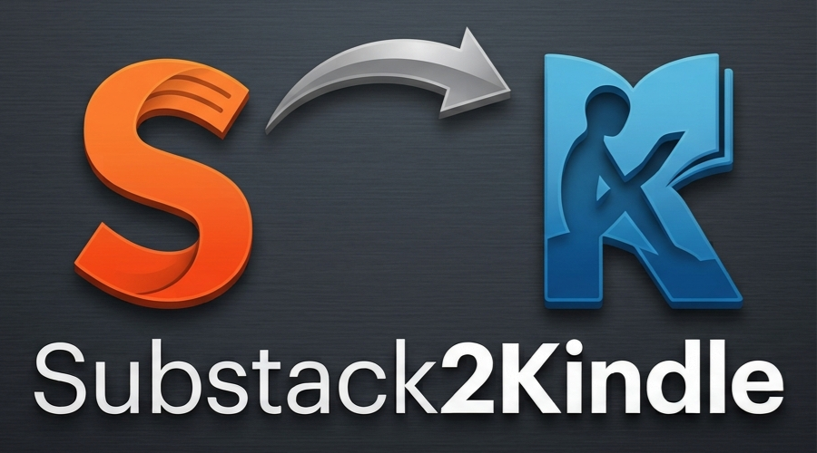

# Substack2Kindle

<p align="center">
  
</p>

Convert Substack articles into Kindle-friendly EPUB files. The converter
creates temporary clean HTML and image files while building the EPUB, then
removes those intermediates so the output folder keeps the EPUB.

## Requirements

- Python 3.10 or newer for running from source or building the Windows executable
- A network connection to the article and its images
- Amazon account access to [Send to Kindle](https://www.amazon.com/sendtokindle)
- Optional: a Gmail app password if you prefer email delivery

## Install

In PowerShell, from the project folder:

```powershell
python -m venv .venv
.\.venv\Scripts\Activate.ps1
python -m pip install -r requirements.txt
```

Amazon Send to Kindle is the default desktop delivery option and needs no
Gmail credentials. For optional Gmail delivery, create `.env` from
`.env.example` and configure:

```dotenv
EMAIL_KINDLE=your_name@kindle.com
EMAIL_PASSWORD=your_gmail_app_password
EMAIL_SENDER=your_gmail_name
SMTP_PORT=587
SMTP_SERVER=smtp.gmail.com
```

`EMAIL_PASSWORD` must be a Google **app password**, not your regular Google
account password. `EMAIL_SENDER` can be your full Gmail address or just the
part before `@gmail.com`. The sender must also be approved in Amazon **Personal
Document Settings**. Keep `.env` private; it is excluded from Git.

## Convert articles

Create an EPUB and email it to your Kindle:

```powershell
python app.py https://example.substack.com/p/article
```

Convert several articles in one run:

```powershell
python app.py https://example.substack.com/p/first https://example.substack.com/p/second
```

Only create local files without sending email:

```powershell
python app.py --no-email https://example.substack.com/p/article
```

Each article produces `output/<article title>.epub`. Clean HTML and downloaded
images are temporary files used during conversion and are deleted after the
EPUB is created successfully. If conversion fails, intermediates are kept to
help diagnose the failure.

Use `--output-dir PATH` to change the output folder. Filenames preserve Polish
letters and spaces. Characters forbidden in Windows filenames (including `?`)
are removed. If an output filename already belongs to another article, a short
URL-based suffix is added.

The EPUB contains the article title and body, excludes embedded
`DigestPostEmbed` article cards, and opens directly to the article. Supported
downloaded image formats are JPEG, PNG, and GIF; unsupported or unavailable
images are skipped and reported.

## Run the desktop app

On Windows, run `dist\Substack2Kindle.exe`. It opens a desktop window where
you can paste up to five Substack article URLs. **Send with Amazon** is
selected by default. After conversion, the app opens Amazon Send to Kindle and
the output folder; sign in to Amazon and upload the generated EPUB file(s).
No Gmail app password or SMTP setup is needed. You can choose **Email through
Gmail** instead if you have configured an app password. Use **Open output
folder** to find the EPUB files.

Download the ready-to-run x64 Windows executable from the project's
[latest GitHub release](https://github.com/Ryeore/Substack2Kindle/releases/latest).
No Python installation is needed to run it. For optional Gmail delivery, use
**Open email settings** to create or edit `.env` with your Kindle address,
Gmail app password, and sender. The executable saves settings and converted
files beside itself.

To build the executable from source, install Python 3.10 or newer and run:

```powershell
python -m pip install -r requirements-build.txt
python -m PyInstaller --noconfirm --clean --onefile --windowed --name Substack2Kindle --add-data ".env.example;." desktop_app.py
```

The standalone executable will be created at `dist\Substack2Kindle.exe`.

## Check the output

Open the EPUB with an ebook reader to review the converted article. Processing
reports each stage and returns a non-zero exit code if an article or Kindle
email fails.

Run the test suite with:

```powershell
python -m unittest -v
```

## Kindle delivery notes

The Kindle address must be enabled for personal document delivery. Amazon may
need to approve the sender email address before accepting documents. Email
delivery was not tested by the unit tests.
